<div align="center">
  <table>
    <tr>
      <td align="center" valign="middle">
        
      </td>
      <td align="center" valign="middle">
        <strong>INSTITUTO POLITÉCNICO NACIONAL</strong><br>
        <strong>ESCUELA SUPERIOR DE CÓMPUTO</strong><br><br>
        Ingeniería en Inteligencia Artificial<br>
        Grupo: 3BV1 &nbsp;|&nbsp; Semestre: 2027-1<br>
        Profesor: Hurtado Avilés Gabriel
      </td>
      <td align="center" valign="middle">
        
      </td>
    </tr>
  </table>
</div>

<div align="center">

# CUESTIONARIO - INTEGRIDAD REFERENCIAL Y CONSULTAS SQL
**Base de Datos:** universidad_avanzada
**Boleta:** 2026630144

</div>

<div align="justify">

### 1. ¿Qué política ON DELETE tiene la tabla 'grupos' hacia 'asignaturas'?
**R:** CASCADE.
**Explicación:** Si se elimina una asignatura, todos los grupos que dependían de esa asignatura se eliminarán automáticamente para mantener la consistencia referencial.  
**SQL:**
```sql
-- Boleta: 2026630144
SELECT on_delete FROM politicas_integridad WHERE tabla = 'grupos' AND campo_fk = 'codigo_asignatura';
```
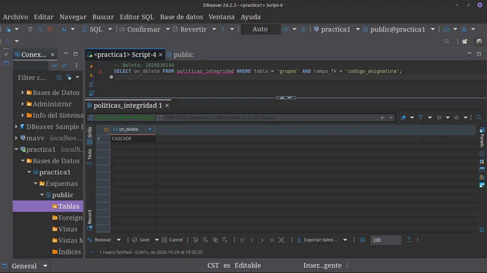

### 2. Si eliminas la asignatura 'CS301', ¿qué sucede con sus grupos?
**R:** Sus grupos se eliminan automáticamente debido a la política ON DELETE CASCADE.  
**SQL:**
```sql
-- Boleta: 2026630144
BEGIN;
DELETE FROM asignaturas WHERE codigo = 'CS301';
SELECT * FROM grupos WHERE codigo_asignatura = 'CS301';
ROLLBACK;
```
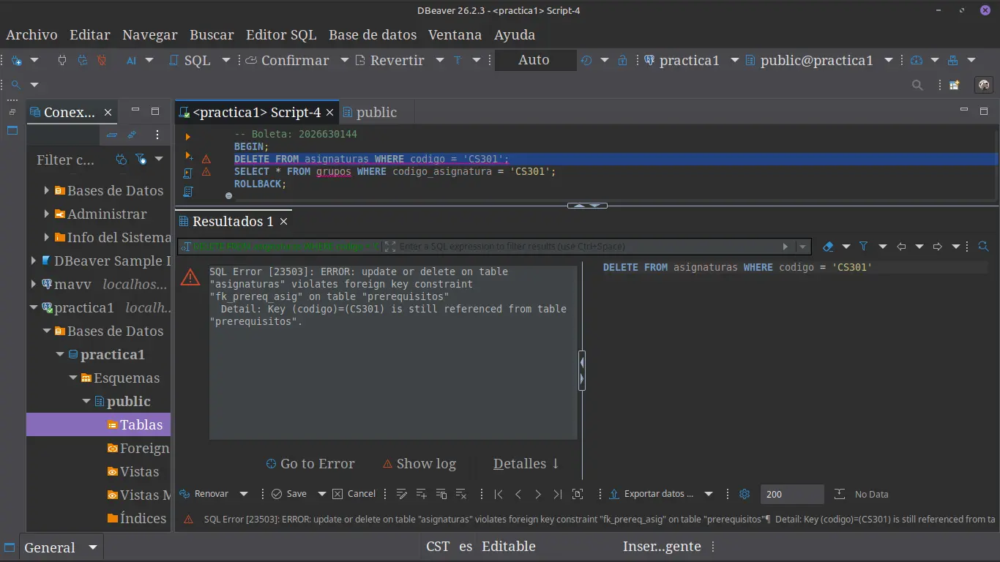

### 3. ¿Qué política ON DELETE tiene la tabla 'profesores' hacia 'departamentos'?
**R:** SET NULL.
**Explicación:** Si se elimina un departamento, los profesores no se borran; su campo `id_departamento` se actualiza a NULL.  
**SQL:**
```sql
-- Boleta: 2026630144
SELECT on_delete FROM politicas_integridad WHERE tabla = 'profesores' AND campo_fk = 'id_departamento';
```
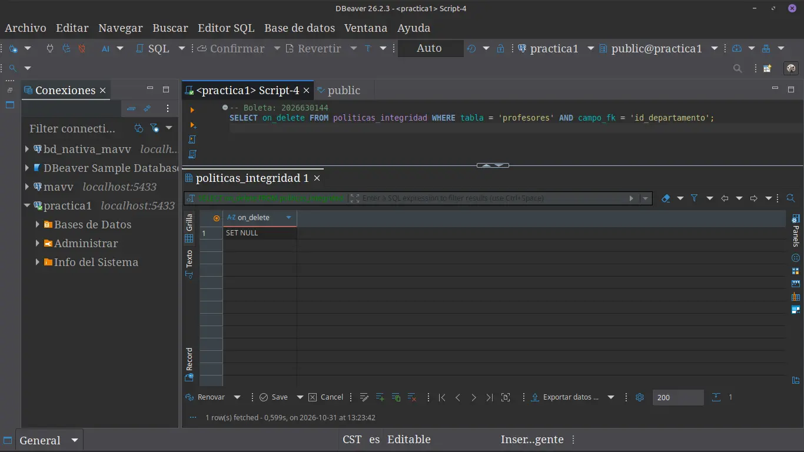

### 4. Si eliminas el departamento con id=1, ¿qué pasa con sus profesores?
**R:** El campo `id_departamento` de esos profesores cambia a NULL. Los profesores siguen existiendo.  
**SQL:**
```sql
-- Boleta: 2026630144
BEGIN;
DELETE FROM departamentos WHERE id_departamento = 1;
SELECT DNI, nombre, id_departamento FROM profesores WHERE DNI IN ('P001', 'P002', 'P008');
ROLLBACK;
```
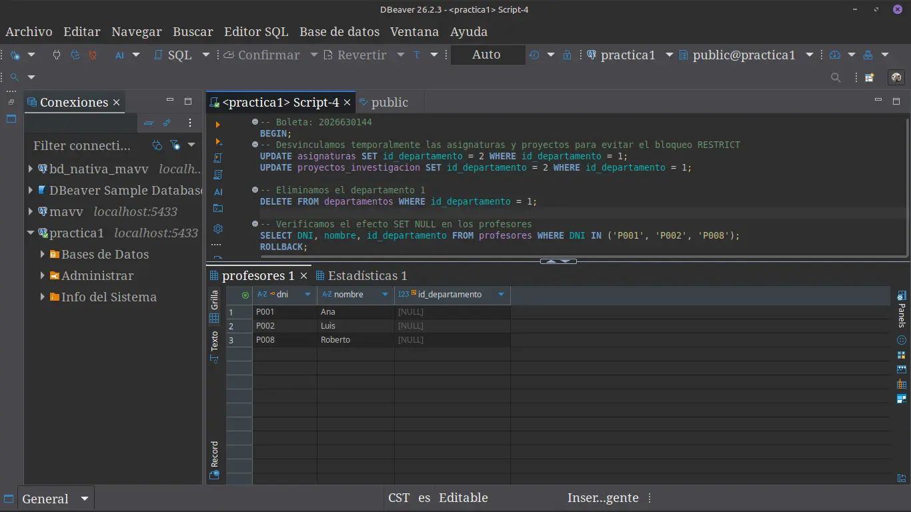

### 5. ¿Por qué NO puedes eliminar la asignatura 'CS101'?
**R:** Porque es un prerrequisito para 'CS102'.
**Política que lo impide:** La tabla `prerequisitos` tiene una llave foránea hacia `asignaturas` con la política ON DELETE RESTRICT.  
**SQL:**
```sql
-- Boleta: 2026630144
BEGIN;
DELETE FROM asignaturas WHERE codigo = 'CS101';
ROLLBACK;
```
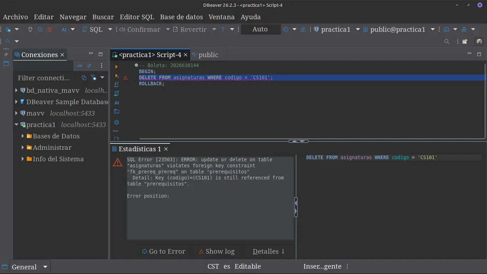

### 6. ¿Qué política ON DELETE tiene la tabla 'inscripciones' hacia 'estudiantes'?
**R:** CASCADE.
**Efecto al eliminar estudiante:** Todas las inscripciones asociadas a ese estudiante se borrarán de la base de datos.  
**SQL:**
```sql
-- Boleta: 2026630144
SELECT on_delete FROM politicas_integridad WHERE tabla = 'inscripciones' AND campo_fk = 'matricula_estudiante';
```
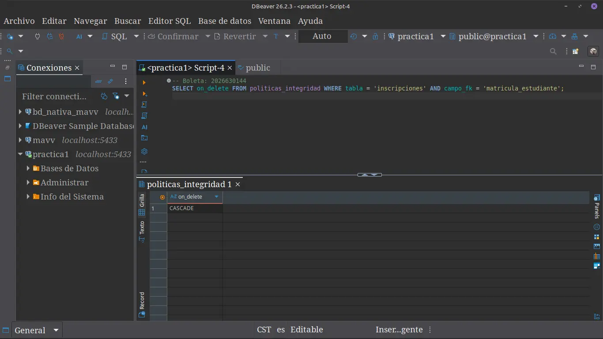

### 7. Si eliminas el estudiante '2022-001', ¿qué sucede con sus inscripciones?
**R:** Se eliminan todas sus inscripciones automáticamente.  
**SQL:**
```sql
-- Boleta: 2026630144
BEGIN;
DELETE FROM estudiantes WHERE matricula = '2022-001';
SELECT * FROM inscripciones WHERE matricula_estudiante = '2022-001';
ROLLBACK;
```
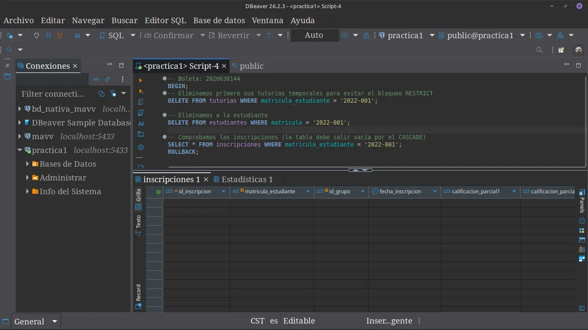

### 8. ¿Qué política ON DELETE tiene la tabla 'tutorias' hacia 'profesores'?
**R:** SET NULL.
**¿Qué pasa con las tutorías si eliminas un profesor?:** El registro de la tutoría se conserva, pero el campo `dni_profesor` queda vacío (NULL).  
**SQL:**
```sql
-- Boleta: 2026630144
SELECT on_delete FROM politicas_integridad WHERE tabla = 'tutorias' AND campo_fk = 'dni_profesor';
```
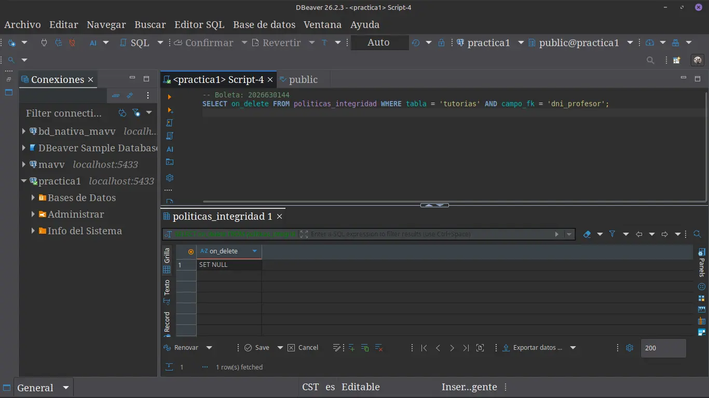

### 9. Si eliminas el proyecto con id_proyecto=3, ¿qué sucede con sus colaboradores?
**R:** Se eliminan los registros de esos colaboradores para ese proyecto específico.
**Política aplicada:** ON DELETE CASCADE en la tabla `colaboradores_proyecto`.  
**SQL:**
```sql
-- Boleta: 2026630144
BEGIN;
DELETE FROM proyectos_investigacion WHERE id_proyecto = 3;
SELECT * FROM colaboradores_proyecto WHERE id_proyecto = 3;
ROLLBACK;
```
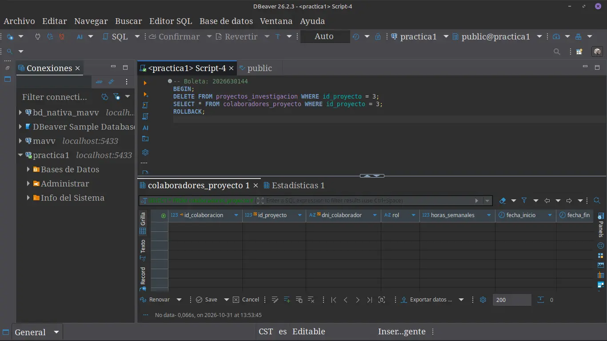

### 10. ¿Qué política ON DELETE tiene 'autores_publicacion' hacia 'publicaciones'?
**R:** CASCADE.
**Efecto al eliminar una publicación:** Todos los registros de autoría vinculados a esa publicación se borran simultáneamente.  
**SQL:**
```sql
-- Boleta: 2026630144
SELECT on_delete FROM politicas_integridad WHERE tabla = 'autores_publicacion' AND campo_fk = 'id_publicacion';
```
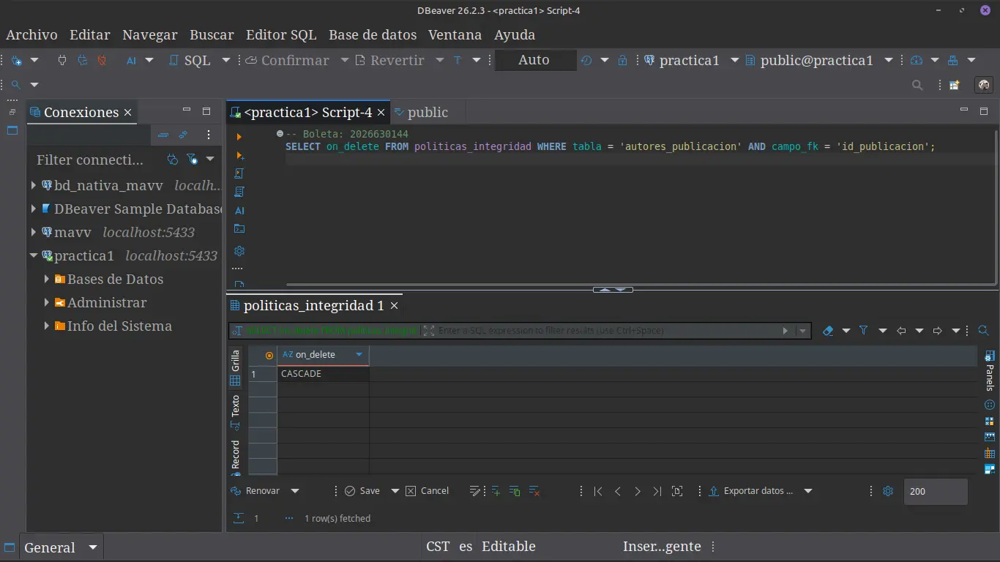

### 11. ¿Qué política ON UPDATE tienen TODAS las foreign keys en esta BD?
**R:** CASCADE.
**Beneficio de esta política:** Permite que al actualizar una llave primaria (DNI, matrícula, código), el cambio se refleje automáticamente en tablas relacionadas, evitando inconsistencias.  
**SQL:**
```sql
-- Boleta: 2026630144
SELECT on_update, COUNT(*) as cantidad
FROM politicas_integridad
GROUP BY on_update;
```
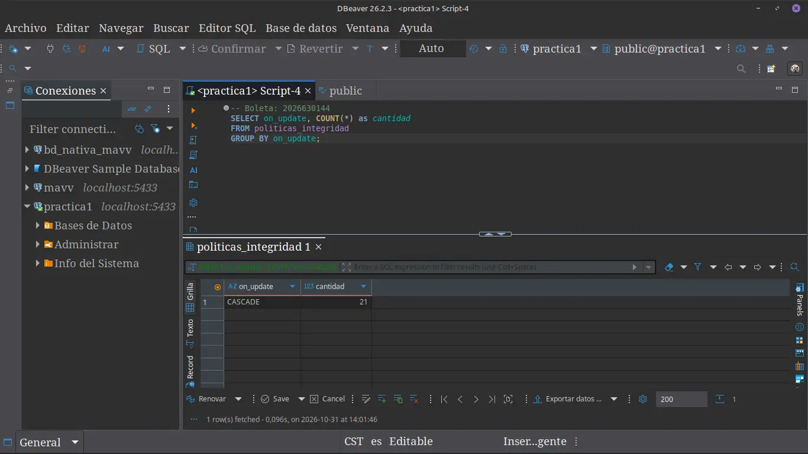

### 12. Si actualizas el DNI del profesor 'P001' a 'P999', ¿qué tablas se actualizan?
**R:** `grupos`, `proyectos_investigacion`, `colaboradores_proyecto`, `autores_publicacion`, `tutorias` y `estudiantes`.  
**SQL:**
```sql
-- Boleta: 2026630144
BEGIN;
UPDATE profesores SET DNI = 'P999' WHERE DNI = 'P001';
SELECT tutor_dni FROM estudiantes WHERE tutor_dni = 'P999';
ROLLBACK;
```
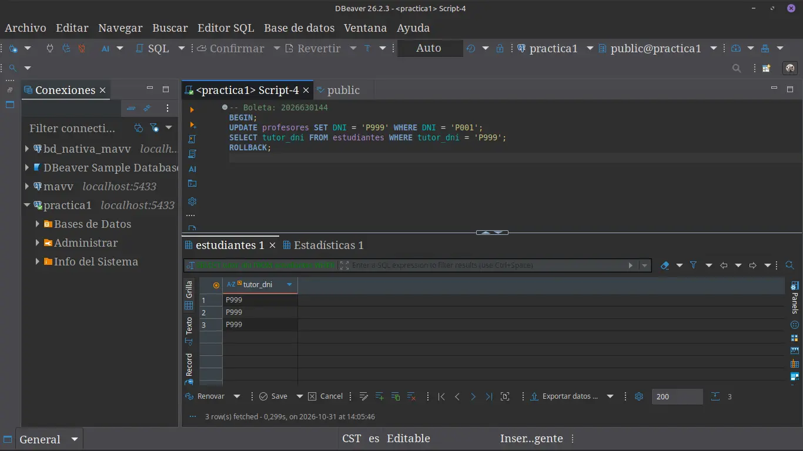

### 13. Si cambias el código de 'CS101' a 'CS001', ¿se actualizan automáticamente los grupos?
**R:** Sí.
**Política que lo permite:** ON UPDATE CASCADE definida en la tabla `grupos`.  
**SQL:**
```sql
-- Boleta: 2026630144
BEGIN;
UPDATE asignaturas SET codigo = 'CS001' WHERE codigo = 'CS101';
SELECT codigo_asignatura FROM grupos WHERE codigo_asignatura = 'CS001';
ROLLBACK;
```
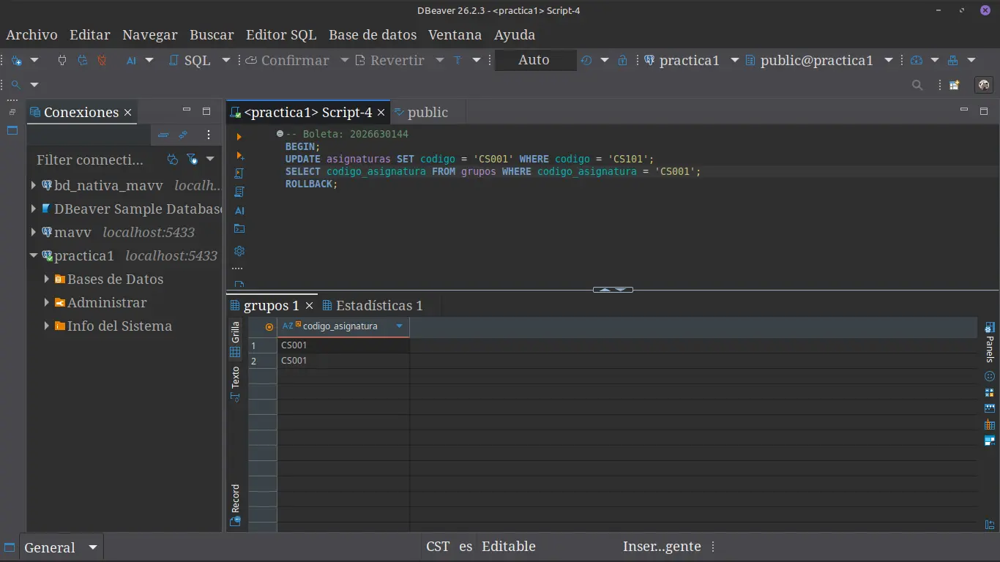

### 14. Si actualizas id_departamento de 1 a 99, ¿qué tablas se ven afectadas?
**R:** `profesores`, `asignaturas` y `proyectos_investigacion`.
**Tablas:** Todas las que tienen una FK referenciando a `departamentos(id_departamento)`.  
**SQL:**

```sql
-- Boleta: 2026630144
BEGIN;
UPDATE departamentos SET id_departamento = 99 WHERE id_departamento = 1;

SELECT 'profesores' AS tabla_afectada, COUNT(*) AS registros FROM profesores WHERE id_departamento = 99
UNION ALL
SELECT 'asignaturas', COUNT(*) FROM asignaturas WHERE id_departamento = 99
UNION ALL
SELECT 'proyectos_investigacion', COUNT(*) FROM proyectos_investigacion WHERE id_departamento = 99;

ROLLBACK;
```

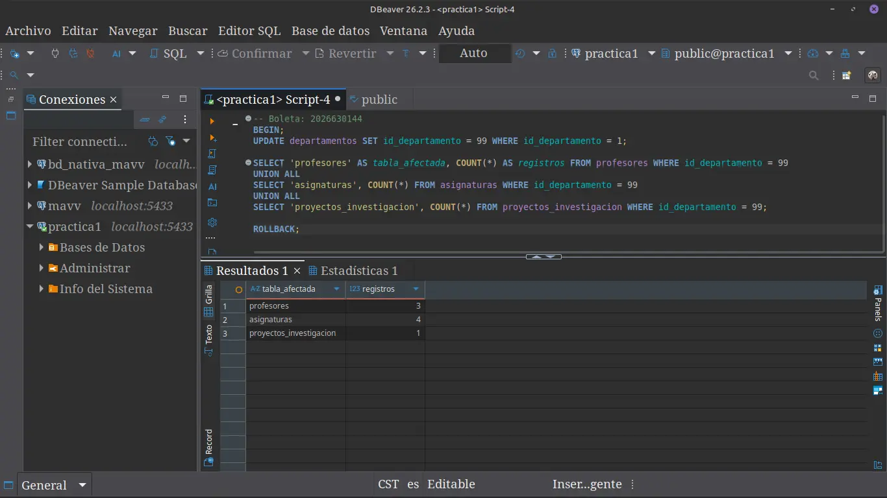

### 15. ¿Por qué es importante ON UPDATE CASCADE en llaves foráneas?
**R:** Evita que queden registros huérfanos y previene errores al corregir identificadores naturales.
**Ejemplo real:** Corregir la matrícula mal capturada de un estudiante; el sistema actualizará sus inscripciones automáticamente.  
**SQL:**

```sql
-- Boleta: 2026630144
BEGIN;
UPDATE estudiantes SET matricula = '2022-999' WHERE matricula = '2022-001';

SELECT matricula_estudiante, id_grupo, fecha_inscripcion 
FROM inscripciones 
WHERE matricula_estudiante = '2022-999';

ROLLBACK;
```

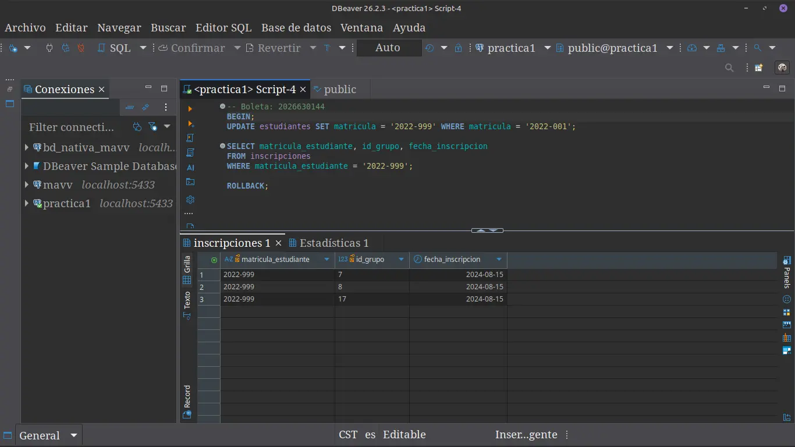


### 16. Diferencia entre CASCADE y RESTRICT en ON DELETE
**R:** CASCADE borra automáticamente los registros dependientes. RESTRICT bloquea el borrado del registro padre si existen registros dependientes.
**Ejemplo de cada uno en esta BD:** CASCADE en `grupos` (hacia asignaturas) y RESTRICT en `asignaturas` (hacia departamentos).  
**SQL:**

```sql
-- Boleta: 2026630144
SELECT tabla, campo_fk, tabla_referenciada, on_delete
FROM politicas_integridad
WHERE (tabla = 'grupos' AND campo_fk = 'codigo_asignatura')
   OR (tabla = 'asignaturas' AND campo_fk = 'id_departamento');
```

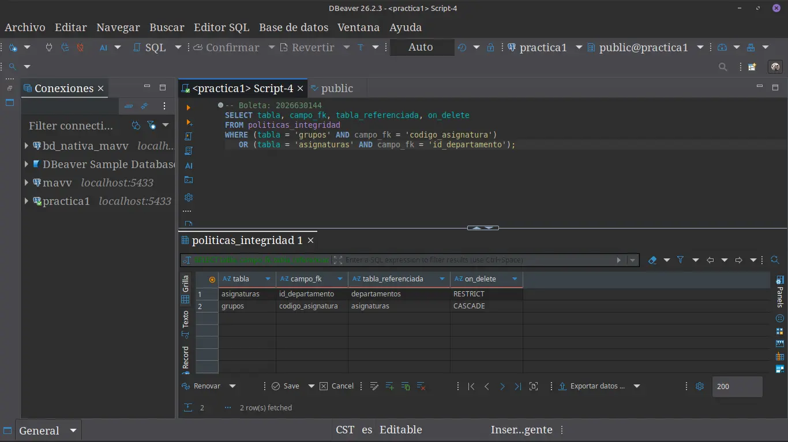

### 17. Diferencia entre SET NULL y CASCADE en ON DELETE
**R:** SET NULL conserva el registro dependiente pero quita la referencia al padre. CASCADE borra el registro dependiente por completo.
**¿Cuándo usar cada uno?:** SET NULL cuando el hijo puede existir sin el padre. CASCADE cuando la existencia del hijo no tiene sentido sin el padre.  
**SQL:**

```sql
-- Boleta: 2026630144
SELECT tabla, campo_fk, tabla_referenciada, on_delete
FROM politicas_integridad
WHERE (tabla = 'profesores' AND campo_fk = 'id_departamento')
   OR (tabla = 'inscripciones' AND campo_fk = 'matricula_estudiante');
```

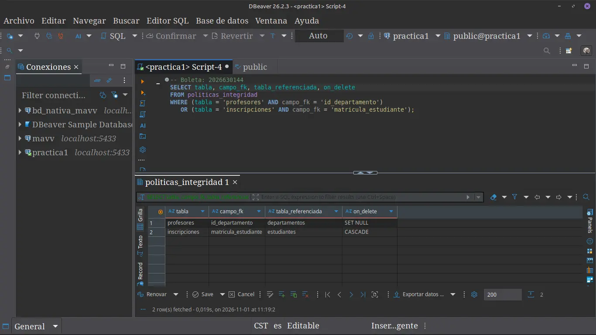


### 18. ¿Por qué 'prerequisitos' usa RESTRICT en lugar de CASCADE?
**R:** Para proteger la malla curricular.
**Justificación:** Evita que al eliminar una asignatura se borren accidentalmente sus vínculos como prerrequisito, desestabilizando los planes de estudio.  
**SQL:**

```sql
-- Boleta: 2026630144
SELECT tabla, campo_fk, tabla_referenciada, on_delete
FROM politicas_integridad
WHERE tabla = 'prerequisitos';
```

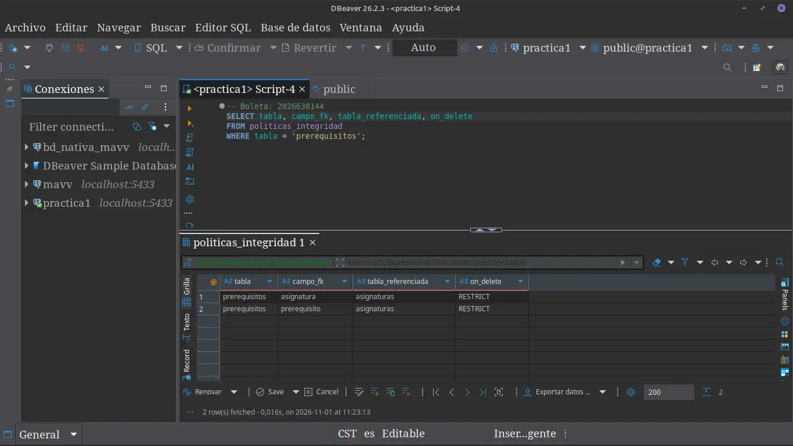

### 19. ¿Por qué 'estudiantes.tutor_dni' usa SET NULL en lugar de RESTRICT?
**R:** Para no bloquear la baja de profesores ni tener que reasignar tutores inmediatamente.
**Caso de uso:** Si un profesor se jubila, el estudiante queda "sin tutor" temporalmente pero no pierde su inscripción.  
**SQL:**

```sql
-- Boleta: 2026630144
SELECT tabla, campo_fk, tabla_referenciada, on_delete
FROM politicas_integridad
WHERE tabla = 'estudiantes' AND campo_fk = 'tutor_dni';
```

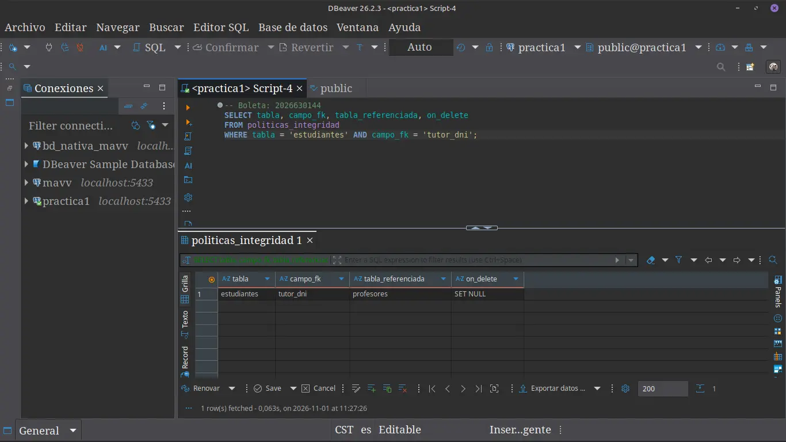

### 20. ¿Cuándo es apropiado usar RESTRICT en lugar de CASCADE?
**R:** Cuando el registro padre es una entidad de configuración o catálogo esencial.
**Criterios de decisión:** Si el registro hijo tiene un valor independiente importante, se usa RESTRICT para obligar al usuario a gestionar dependencias manualmente antes de borrar.  
**SQL:**

```sql
-- Boleta: 2026630144
SELECT tabla, campo_fk, tabla_referenciada, on_delete
FROM politicas_integridad
WHERE on_delete = 'RESTRICT';
```

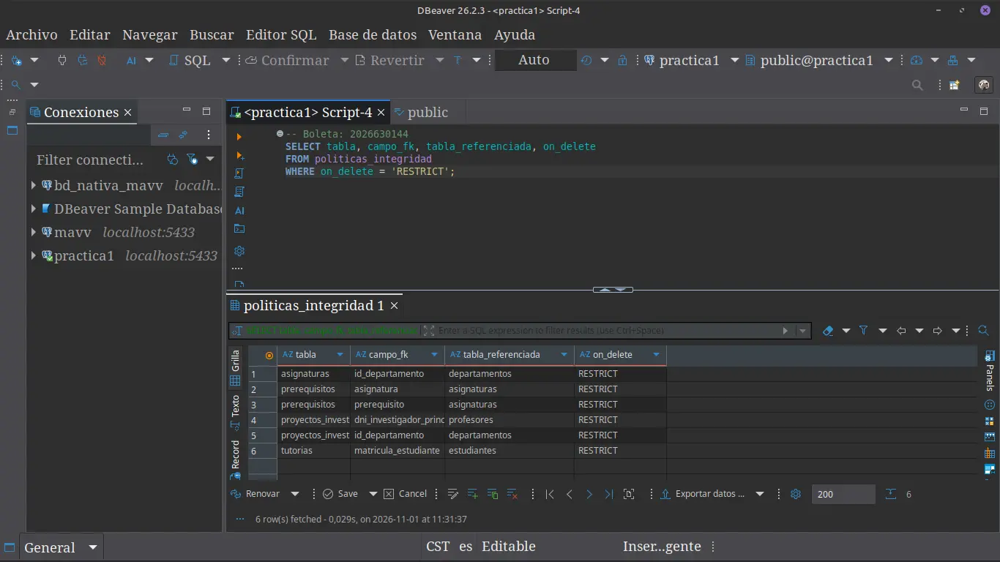

### 21. Lista el nombre completo de todos los profesores con su departamento
**R:** Se muestra en la captura  
**SQL:**
```sql
-- Boleta: 2026630144
SELECT p.nombre, p.apellido, d.nombre AS departamento 
FROM profesores p 
LEFT JOIN departamentos d ON p.id_departamento = d.id_departamento;
```

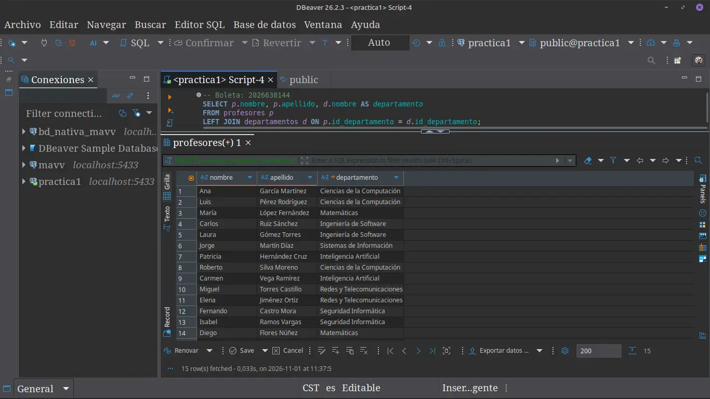

### 22. ¿Cuántos estudiantes están inscritos en asignaturas del departamento 'Ciencias de la Computación'?
**R:** 7 estudiantes.  
**SQL:**
```sql
-- Boleta: 2026630144
SELECT COUNT(DISTINCT i.matricula_estudiante) AS total_estudiantes
FROM inscripciones i 
JOIN grupos g ON i.id_grupo = g.id_grupo 
JOIN asignaturas a ON g.codigo_asignatura = a.codigo 
JOIN departamentos d ON a.id_departamento = d.id_departamento 
WHERE d.nombre = 'Ciencias de la Computación';
```

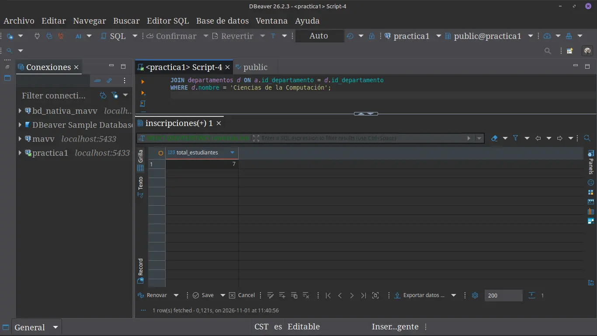

### 23. Muestra todas las asignaturas con sus prerequisitos (nombre de ambas)
**R:** Se muestra en la captura  
**SQL:**
```sql
-- Boleta: 2026630144
SELECT a1.nombre AS Asignatura, a2.nombre AS Prerequisito 
FROM prerequisitos p 
JOIN asignaturas a1 ON p.asignatura = a1.codigo 
JOIN asignaturas a2 ON p.prerequisito = a2.codigo;
```

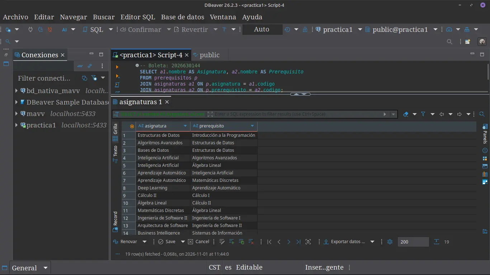

### 24. ¿Cuántos profesores de categoría 'TIT' imparten grupos en semestre 2024-1?
**R:** 6 profesores.  
**SQL:**
```sql
-- Boleta: 2026630144
SELECT COUNT(DISTINCT p.DNI) AS total_titulares
FROM profesores p 
JOIN grupos g ON p.DNI = g.dni_profesor 
WHERE p.categoria = 'TIT' AND g.semestre = '2024-1';
```

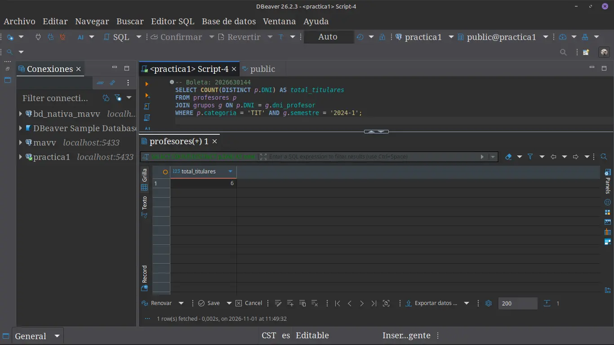

### 25. ¿Cuántos estudiantes tienen como tutor a un profesor del departamento 'Matemáticas'?
**R:** 2 estudiantes.  
**SQL:**
```sql
-- Boleta: 2026630144
SELECT COUNT(e.matricula) AS total_estudiantes
FROM estudiantes e 
JOIN profesores p ON e.tutor_dni = p.DNI 
JOIN departamentos d ON p.id_departamento = d.id_departamento 
WHERE d.nombre = 'Matemáticas';
```

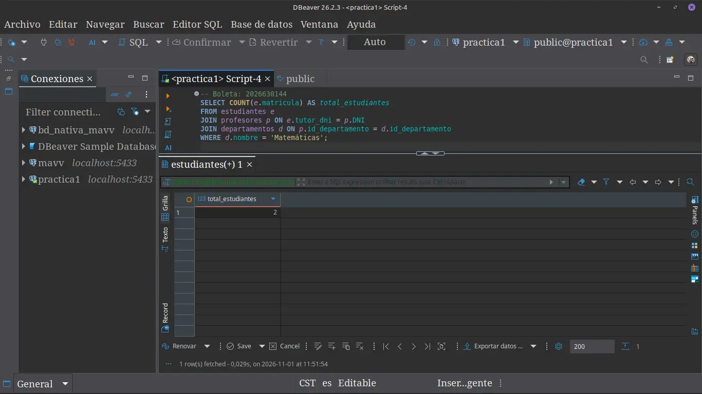

### 26. ¿Cuál es el nombre del profesor con el salario más alto?
**R:** Patricia Hernández Cruz.  
**SQL:**
```sql
-- Boleta: 2026630144
SELECT nombre, apellido, salario 
FROM profesores 
ORDER BY salario DESC LIMIT 1;
```

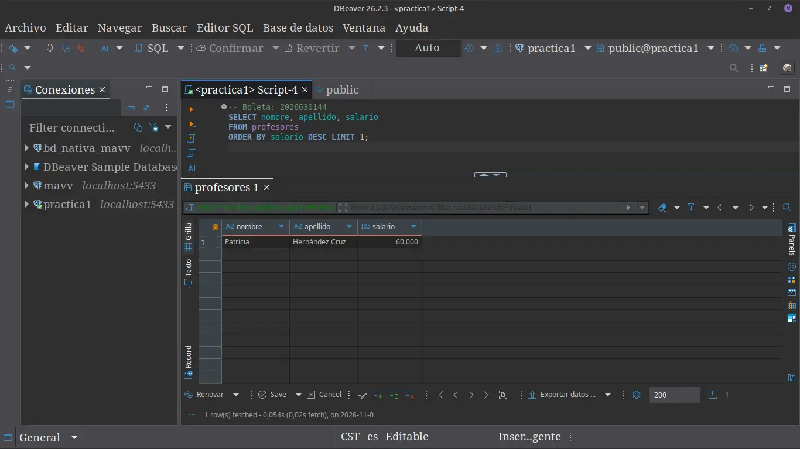

### 27. ¿Cuántos profesores ganan más que el salario promedio?
**R:** 6 profesores.  
**SQL:**
```sql
-- Boleta: 2026630144
SELECT COUNT(*) AS cantidad_profesores
FROM profesores 
WHERE salario > (SELECT AVG(salario) FROM profesores);
```

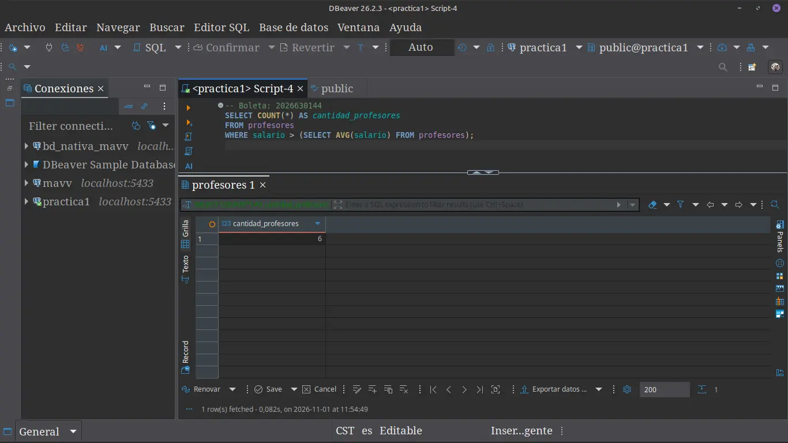

### 28. ¿Cuál es el nombre del estudiante con el promedio más alto?
**R:** Carmen Flores Vega.  
**SQL:**
```sql
-- Boleta: 2026630144
SELECT nombre, apellido, promedio 
FROM estudiantes 
ORDER BY promedio DESC LIMIT 1;
```

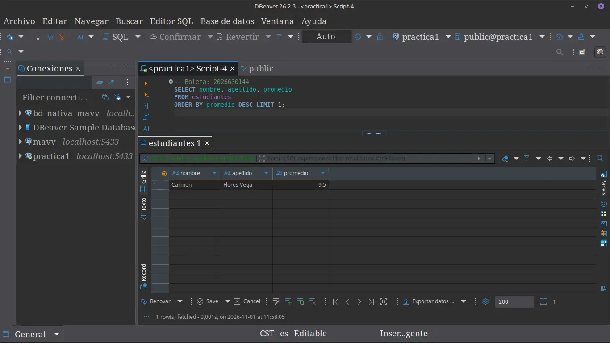

### 29. ¿Cuántas asignaturas tienen más créditos totales (teoría+práctica) que el promedio?
**R:** 6 asignaturas.  
**SQL:**
```sql
-- Boleta: 2026630144
SELECT COUNT(*) AS asignaturas_sobre_promedio
FROM asignaturas 
WHERE (creditos_teoria + creditos_practica) > 
      (SELECT AVG(creditos_teoria + creditos_practica) FROM asignaturas);
```

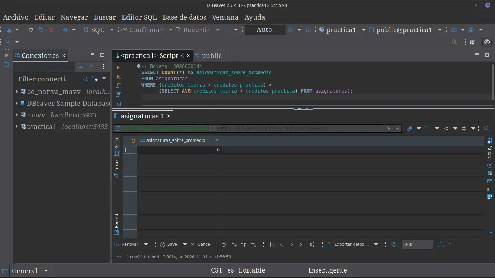

### 30. ¿Qué departamento tiene el mayor presupuesto? (nombre)
**R:** Inteligencia Artificial.  
**SQL:**
```sql
-- Boleta: 2026630144
SELECT nombre 
FROM departamentos 
ORDER BY presupuesto DESC LIMIT 1;
```

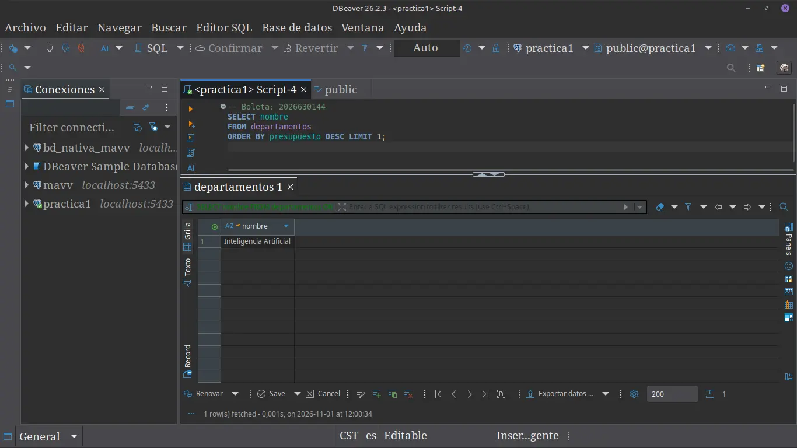

### 31. ¿Qué departamento tiene más profesores? (nombre y cantidad)
**R:** Ciencias de la Computación (3 profesores).  
**SQL:**
```sql
-- Boleta: 2026630144
SELECT d.nombre, COUNT(p.DNI) AS cantidad_profesores 
FROM departamentos d 
JOIN profesores p ON d.id_departamento = p.id_departamento 
GROUP BY d.id_departamento, d.nombre 
ORDER BY cantidad_profesores DESC LIMIT 1;
```

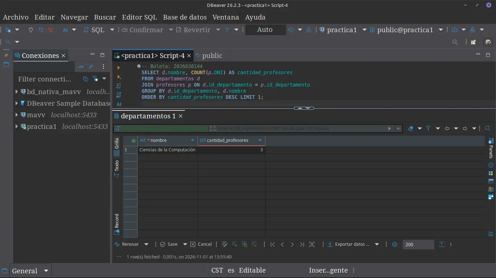

### 32. ¿Qué profesor imparte más grupos en semestre 2024-1? (nombre completo)
**R:** Ana García Martínez.  
**SQL:**
```sql
-- Boleta: 2026630144
SELECT p.nombre, p.apellido, COUNT(g.id_grupo) AS total_grupos 
FROM profesores p 
JOIN grupos g ON p.DNI = g.dni_profesor 
WHERE g.semestre = '2024-1' 
GROUP BY p.DNI, p.nombre, p.apellido 
ORDER BY total_grupos DESC LIMIT 1;
```

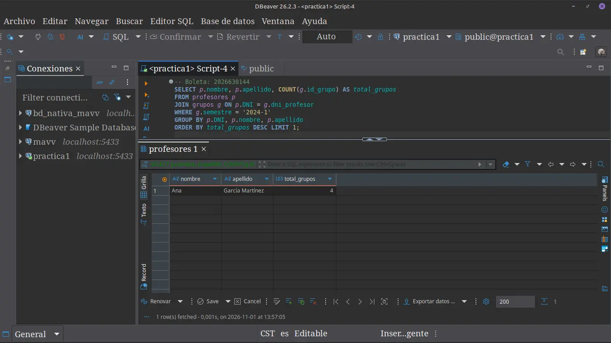

### 33. ¿Cuántos estudiantes tiene cada tutor? (solo tutores con más de 2 estudiantes)
**R:** Ana García Martínez (3).  
**SQL:**
```sql
-- Boleta: 2026630144
SELECT p.nombre, p.apellido, COUNT(e.matricula) as total_estudiantes 
FROM estudiantes e
JOIN profesores p ON e.tutor_dni = p.DNI
WHERE e.tutor_dni IS NOT NULL 
GROUP BY p.DNI, p.nombre, p.apellido 
HAVING COUNT(e.matricula) > 2;
```

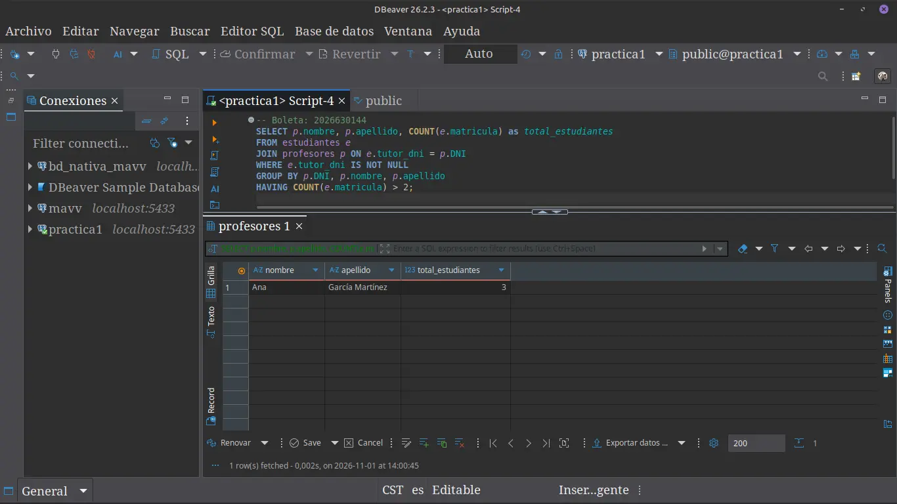

### 34. ¿Cuál es el promedio de calificaciones finales de estudiantes aprobados?
**R:** 8.88.  
**SQL:**
```sql
-- Boleta: 2026630144
SELECT ROUND(AVG(calificacion_final), 2) AS promedio_aprobados
FROM inscripciones 
WHERE estado = 'Aprobado';
```

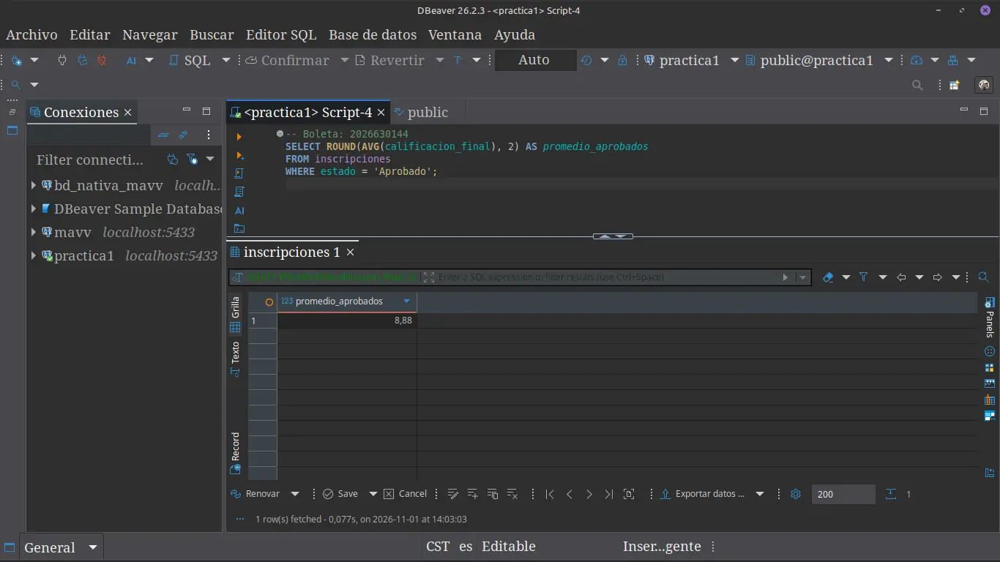

### 35. ¿Cuántas asignaturas hay por cada nivel? (Básico, Intermedio, Avanzado, Especialización)
**R:** Intermedio (8), Avanzado (7), Básico (4), Especialización (2).  
**SQL:**
```sql
-- Boleta: 2026630144
SELECT nivel, COUNT(*) as cantidad 
FROM asignaturas 
GROUP BY nivel 
ORDER BY cantidad DESC;
```

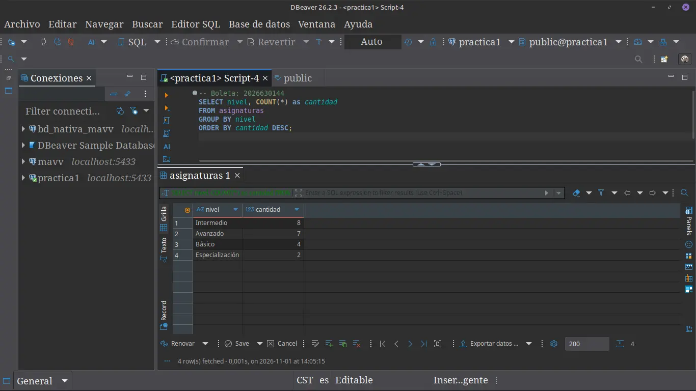

### 36. ¿Cuántos grupos están al límite o sobrecupo (inscritos >= cupo)?
**R:** 2 grupos.  
**SQL:**
```sql
-- Boleta: 2026630144
SELECT COUNT(*) AS grupos_llenos
FROM grupos 
WHERE inscritos >= cupo;
```

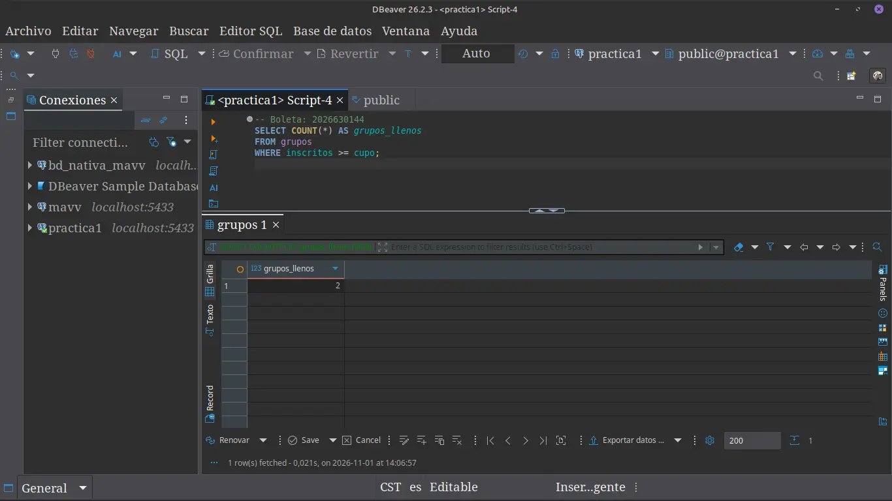

### 37. ¿Cuántas asignaturas NO tienen prerequisitos?
**R:** 6 asignaturas.  
**SQL:**
```sql
-- Boleta: 2026630144
SELECT COUNT(*) AS sin_prerequisitos
FROM asignaturas a 
LEFT JOIN prerequisitos p ON a.codigo = p.asignatura 
WHERE p.asignatura IS NULL;
```

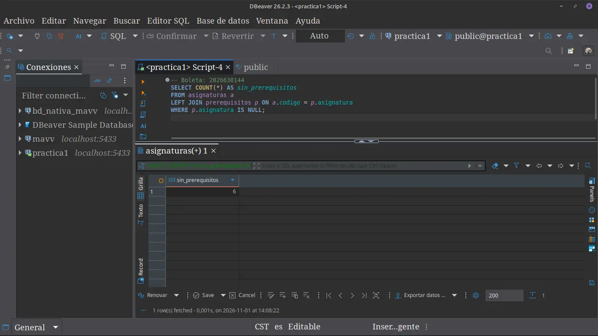

### 38. ¿Cuántos profesores NO imparten grupos en el semestre 2024-1?
**R:** 1 profesor.  
**SQL:**
```sql
-- Boleta: 2026630144
SELECT COUNT(*) AS profesores_sin_grupo
FROM profesores p 
LEFT JOIN grupos g ON p.DNI = g.dni_profesor AND g.semestre = '2024-1' 
WHERE g.id_grupo IS NULL;
```


### 39. ¿Cuántos estudiantes tienen promedio superior al promedio general?
**R:** 8 estudiantes.  
**SQL:**
```sql
-- Boleta: 2026630144
SELECT COUNT(*) AS sobre_promedio_general
FROM estudiantes 
WHERE promedio > (SELECT AVG(promedio) FROM estudiantes);
```

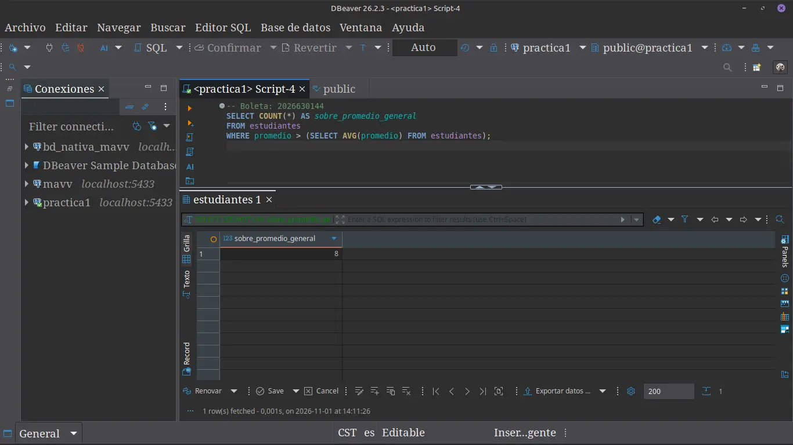

### 40. ¿Cuál es la asignatura más popular (más inscripciones) en semestre 2024-1?
**R:** Estructura de Datos.  
**SQL:**
```sql
-- Boleta: 2026630144
SELECT a.nombre, COUNT(i.id_inscripcion) AS total_inscripciones 
FROM asignaturas a 
JOIN grupos g ON a.codigo = g.codigo_asignatura 
JOIN inscripciones i ON g.id_grupo = i.id_grupo 
WHERE g.semestre = '2024-1' 
GROUP BY a.codigo, a.nombre 
ORDER BY total_inscripciones DESC LIMIT 1;
```

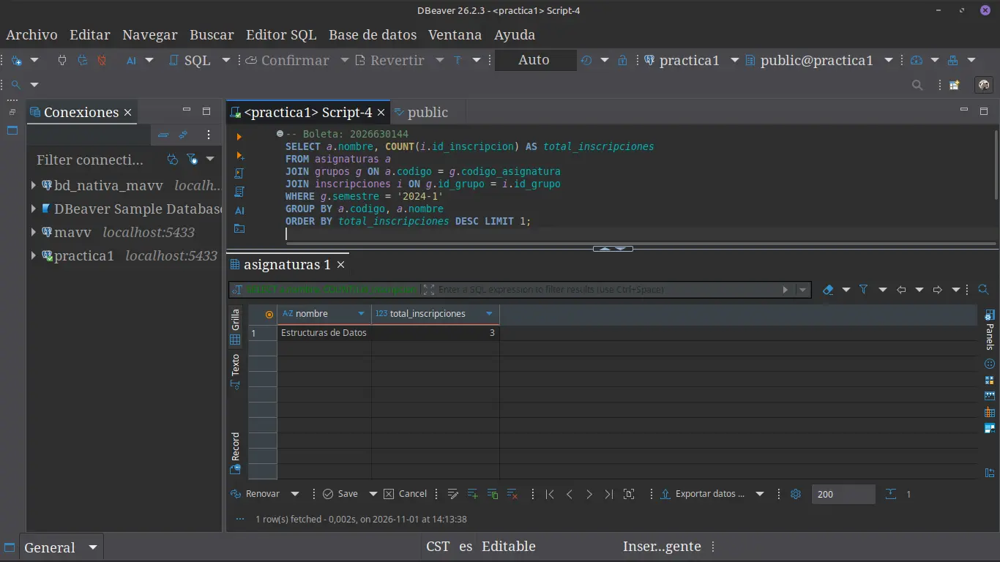

</div>